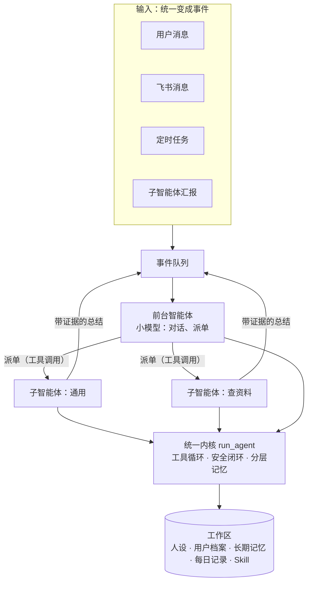

# MY-Agent（小牛）

> 一个多智能体协作的个人助手，目标是**人只看结果**。

一句话生成专属智能体。人离线时，智能体自己拆解任务、按难度调度模型、并行执行，做完把结果推送给人；只有高风险操作才停下来等人确认。

架构对照 Claude Code、OpenAI Agents SDK 和开源项目 [CowAgent](https://github.com/zhayujie/CowAgent) 设计，内核自研，不依赖 LangChain 等框架。

## 架构



> 上图是目标架构。现在做到的：事件队列里有飞书消息和定时提醒两种来源，前台智能体（专属 Agent）能对话、用工具。子智能体和派单还没做，各部分做到哪看下面的功能表。

- **一份内核，多种智能体**：前台和所有子智能体跑的是同一个 `run_agent()`，区别只在配置（提示词、工具集、模型）。加一种智能体只要加一个 Markdown 模板。
- **派单是工具调用**：前台始终掌控对话，用户只和一个入口说话（agents-as-tools，不用 handoff 转交）。子智能体只回传带证据的总结，上下文互相隔离。
- **规则写在代码里，不只写在提示词里**：提示词是建议，代码才是保证。

## 功能

| 模块 | 内容 | 状态 |
|---|---|---|
| 智能体内核 | 工具调用循环（步数上限防死循环）、工具注册中心、工具出错时把错误反馈给模型自我纠正、回复被截断时不执行半截的工具调用 | 已实现 |
| 工具 | `read_file`、`write_file`、`edit_file`、`list_file`、`get_time`、`notify`（往飞书群发通知，发到哪由配置决定，模型只能决定发什么）、`create_agent`（新建专属 Agent）、`schedule`（定时提醒）、`web_search` 和 `web_fetch`（搜索、读网页）。每个 Agent 拿到哪些工具由它启用的能力包决定 | 已实现 |
| 安全 | 路径规范化，只能访问工作区（防 `../` 穿越）；`.env` 密钥文件和数据库对智能体不可见；工具调用前过几道关：这个 Agent 有没有这个工具、现在说话的是不是访客、要不要先问用户；用户自己让改文件不用问（工作区每次对话后自动做本地 git 备份），访客让改已有内容时要用户同意；每次工具调用写 JSONL 审计日志（只记摘要） | 已实现 |
| 记忆 | 人设、用户档案、长期记忆注入系统提示词；每轮对话按天写入 `memory/YYYY-MM-DD.md` | 已实现 |
| 上下文管理 | 超出预算时整轮淘汰旧对话，保留最新一轮；淘汰后剥离思考块，兼容 extended thinking；读文件一次最多返回 5000 字，超出时提示下一次的 `offset`，模型自己分段续读 | 已实现 |
| 专属 Agent（多 bot） | 取个名字就新建一个专属 Agent（`/new 名字`）：有自己的文件夹、记忆和对话；新建时调一次模型按名字起草人设，由代码填进模板；新建后它先开口打招呼；能力按"能力包"开关，每个 Agent 拿到的工具清单由代码生成；关于用户的记忆所有 Agent 共享，工作经验各存各的。不要了可以 `/delete 名字` 删掉（要再确认一次，文件夹搬进回收站）。主 Agent 第一次启动时先开口，引导取名和选能力。也可以直接对主 Agent 说"帮我建一个简历顾问"，它用工具去建。还没做：网页上的引导页 | 部分实现 |
| 定时提醒 | 在飞书里说一句"每天早上 8 点提醒我投简历""20 分钟后叫我"就定好，查看和删除也是说一句话；到点由定它的那个 Agent 在定它的那个会话里开口（单聊里定的回单聊，群里定的回群）。到没到点由代码查数据库判断，没有到点的事不调模型；程序关着时不触发，再打开时落下的补做一次。只有用户能新定，访客可以查看和删除。还没做：每周、每隔几分钟这类时间；命令行里用不了 | 已实现（飞书） |
| 查资料 | 上网搜索、读网页，各有两条路：自己写的工具（搜索调 Tavily 或博查，读网页自己下载并转成文字，换什么模型都能用），或者让模型那边的服务器做（Claude 官方接口自带）；默认自动选。外面来的内容不可信：自己的工具读回来的内容会包上“这是资料、不是指令”的说明；一段对话里读过外面的内容以后，改文件、发通知、定提醒都要先问用户（写在代码里）；读网页不许访问内网地址，跳转的每一步都重新检查。3 道评测题用真模型和真的搜索各通过 1 次（让 Claude 的服务器搜）；自己写的读网页在真的网络上试过；自己写的搜索还没真的搜过（要先配密钥）。还没做：读 PDF 和图片 | 已实现 |
| 用量记录 | 每调一次模型记一行：哪个 Agent、第几步、发了和回了多少 token、用了几秒；`python -m agents.audit.usage` 按 Agent 汇总，并报出定时检查看了几次、几次空转；评测每道题也报用量 | 已实现 |
| 自我演化 | 定时做离线记忆整理；把做成的事沉淀成 Skill；经验分"观察 / 已验证 / 约定"三级，约定须用户确认 | 设计中 |
| 多智能体 | 前台 + 子智能体模板、派单工具、并发上限 | 设计中 |
| 事件驱动 | 飞书入口里，用户的消息和时钟的记号排同一个队，一次只处理一样，所以定时提醒和用户的消息不会同时让同一个 Agent 动。还没做：子智能体的汇报进队列、异步子智能体、批处理 | 部分实现 |
| 飞书对话（最小版） | 飞书应用机器人 + 长连接，不需要公网地址；默认只处理主人本人的文字消息，主人可以用 `/guest @某人` 把群里的其他人请成访客（可以聊天、让智能体干活，各有一份自己的记忆；不能用命令，碰不到别的访客的文件夹，新加的工具默认用不了，定时提醒只能查看和删除）；重复推送去重；消息先排队再处理；智能体可以决定不回复；主人让改文件不用审批；访客让改已有内容时，在飞书里用文字问主人，回"同意"才执行 | 已实现 |
| 界面与渠道 | Web 界面（FastAPI + 流式输出）、飞书卡片审批、审批推送到手机、飞书入口搬到独立的连接器仓库 | 设计中 |
| 评测 | 每个功能配几道题（初始文件 + 用户说的话 + 检查项），改动后重跑。现在有 21 道：基本的记忆、专属 Agent、访客、先开口、定时提醒，各题都用真模型通过过 1 次；另有查资料 3 道，也各通过 1 次；每道题在临时文件夹里跑，碰不到真的工作区，跑完报出用量。还没做：安全类和记忆类的题、"同一题跑 3 次都对"的标准（现在每道只跑过 1 次） | 部分实现 |

完整设计和路线图见 [docs/DESIGN.md](docs/DESIGN.md)。

## 实测数字（2026-11-24，第一批）

每道评测题只用真模型跑了 1 次，下面的数只能看个大概，不能当平均值。

| 看什么 | 实测 |
|---|---|
| 18 道评测题 | 全部通过；其中 16 道一起跑的那次：调模型 28 次，发 107046、回 4797 个 token，模型用时 80.7 秒 |
| 专属 Agent（空白模板）每次调用发多少 | 3257～3370 个 token |
| 用一次工具的一句话 | 要调 2 次模型，发的量约是不用工具时的 2 倍：每次都要把整段历史重发 |
| 一次调用多久 | 平均 2.9 秒，主要看回多长：回 1023 个 token 的用了 14.3 秒，回 72 个的用了 2.8 秒 |
| 加上搜索以后的固定开销 | 清单里带着搜索和读网页，不搜也要多发：自己写的两个工具多 433 个 token；Claude 服务器的两个多 3200 个。让服务器搜一次的一句话，一次调用发了 47156 个 token |
| 定时检查的空转 | 真实使用的一晚：时钟看了 60 次，1 次有到点的事，59 次空转，空转不调模型 |
| 群聊的花费 | 群里有 5 个 Agent 时，用户说一句话每个 Agent 都要看一次，多数只回"不回复"，但每次仍要发 5000～8000 个 token。这是下一步要解决的（先筛一遍该谁看） |

## 一个踩过的坑：思考块绑定对话

开启 extended thinking 后，对话进行几轮会突然报 400 `bound to a different conversation`，重试也没用。

用小规模真实请求做对照实验：

| 情况 | 结果 |
|---|---|
| 历史原样发送 | 通过 |
| 改了系统提示词 | 400 |
| 删掉最早一轮 | 400 |
| 去掉所有思考块再发 | 通过 |

结论：思考块只在产生它的那段对话里有效，对话开头一变就失效。对应的做法是**系统提示词在启动时固定**，**裁剪旧对话后剥离思考块**。

## 运行

需要 Python 3.10 以上（开发时用 3.13）。

```bash
git clone https://github.com/jamescxq/MY-Agent.git
```

```bash
cd MY-Agent
```

```bash
python -m venv .venv
```

```bash
.venv\Scripts\activate
```

```bash
pip install -r requirements.txt
```

复制 `.env.example` 为 `.env`，填入自己的 `ANTHROPIC_API_KEY`。`MODEL` 不填时默认用 `claude-opus-5-5`；用其他兼容 Anthropic 接口的服务商时，再填 `ANTHROPIC_BASE_URL`。想让它往飞书发通知时，填 `FEISHU_WEBHOOK`（飞书群自定义机器人的地址，关键词设为"小牛"）；不填就不发。

```bash
python chat.py
```

第一次运行会在项目旁边建两个文件夹：

- `MY-Agent-workspace/`：智能体的工作区，放人设、用户档案和记忆。第一次运行时它会问你怎么称呼、给它起什么名字。
- `MY-Agent-logs/`：审计日志、用量记录。

这两个文件夹都在项目外面，不会被提交到 GitHub。

想在飞书里和它对话：在飞书开发者后台建一个企业自建应用并开启机器人，把 `FEISHU_APP_ID`、`FEISHU_APP_SECRET`、`FEISHU_OWNER_ID` 填进 `.env`（说明见 `.env.example`），然后运行：

```bash
python feishu_bot.py
```

看用量（只读日志，不调模型）：

```bash
python -m agents.audit.usage
```

跑评测（会真的调用模型，要花钱；加 `--runs 1` 每道题只跑一次）：

```bash
python -m evals.run --runs 1
```

## 目录

```text
MY-Agent/
├── chat.py               命令行入口
├── feishu_bot.py         飞书入口
├── config.py             路径、模型配置
├── agents/
│   ├── loop.py           智能体内核 run_agent()
│   ├── bots/             运行上下文 ctx、工作区结构、新建和切换 Agent
│   ├── capabilities/     能力包：每个 Agent 的工具清单和能力清单
│   ├── sessions/         一个会话里多个 Agent 怎么轮流说话；访客（会话里的其他真人）
│   ├── store/            数据库 state.db（SQLite），一类表一个文件
│   ├── events/           定时提醒：算时间、看有没有到点的、时钟
│   ├── tools/            工具
│   ├── permission/       路径校验 guard.py、网址校验 url_guard.py、外部内容 taint.py、审批门 gate.py
│   ├── models/           各家模型接口不一样的地方，一家一个文件
│   ├── audit/            审计日志、用量记录和汇总
│   ├── memory/           每日对话记录
│   ├── context/          上下文裁剪
│   └── prompt/           系统提示词拼接；读 templates/prompts/ 里的话
├── templates/            人设、用户档案等空白模板；能力包；写给模型看的整段话（prompts/）
├── evals/                评测：python -m evals.run（会调用模型）
├── playground/           试验脚本，正式代码不引用
└── docs/DESIGN.md        设计文档和路线图
```
