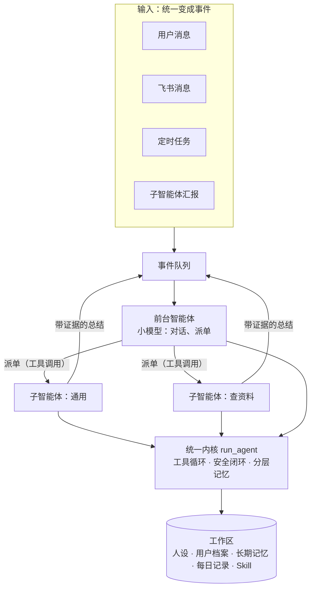

# MY-Agent（小牛）

> 一个多智能体协作的个人助手，目标是**人只看结果**。

一句话生成专属智能体。人离线时，智能体自己拆解任务、按难度调度模型、并行执行，做完把结果推送给人；只有高风险操作才停下来等人确认。

架构对照 Claude Code、OpenAI Agents SDK 和开源项目 [CowAgent](https://github.com/zhayujie/CowAgent) 设计，内核自研，不依赖 LangChain 等框架。

## 架构



- **一份内核，多种智能体**：前台和所有子智能体跑的是同一个 `run_agent()`，区别只在配置（提示词、工具集、模型）。加一种智能体只要加一个 Markdown 模板。
- **派单是工具调用**：前台始终掌控对话，用户只和一个入口说话（agents-as-tools，不用 handoff 转交）。子智能体只回传带证据的总结，上下文互相隔离。
- **规则写在代码里，不只写在提示词里**：提示词是建议，代码才是保证。

## 功能

| 模块 | 内容 | 状态 |
|---|---|---|
| 智能体内核 | 工具调用循环（步数上限防死循环）、工具注册中心、工具出错时把错误反馈给模型自我纠正、回复被截断时不执行半截的工具调用 | 已实现 |
| 工具 | `read_file`、`write_file`、`edit_file`、`list_file`、`get_time`、`notify`（往飞书群发通知，发到哪由配置决定，模型只能决定发什么） | 已实现 |
| 安全 | 路径规范化，只能访问工作区（防 `../` 穿越）；`.env` 密钥文件对智能体不可见；覆盖已有文件前人工确认；每次工具调用写 JSONL 审计日志（只记摘要） | 已实现 |
| 记忆 | 人设、用户档案、长期记忆注入系统提示词；每轮对话按天写入 `memory/YYYY-MM-DD.md` | 已实现 |
| 上下文管理 | 超出预算时整轮淘汰旧对话，保留最新一轮；淘汰后剥离思考块，兼容 extended thinking；读文件一次最多返回 5000 字，超出时提示下一次的 `offset`，模型自己分段续读 | 已实现 |
| 专属 Agent（多 bot） | 取个名字就新建一个专属 Agent，有自己的人设、记忆和对话，新建后主动打招呼；能力按"能力包"开关；关于用户的记忆所有 Agent 共享，工作经验各存各的 | 设计中 |
| 自我演化 | 定时做离线记忆整理；把做成的事沉淀成 Skill；经验分"观察 / 已验证 / 约定"三级，约定须用户确认 | 设计中 |
| 多智能体 | 前台 + 子智能体模板、派单工具、并发上限 | 设计中 |
| 事件驱动 | 事件队列、异步子智能体、批处理 | 设计中 |
| 飞书对话（最小版） | 飞书应用机器人 + 长连接，不需要公网地址；只处理主人本人的文字消息；重复推送去重；消息先排队再处理；智能体可以决定不回复；需要审批的操作在飞书里一律拒绝 | 已实现 |
| 界面与渠道 | Web 界面（FastAPI + 流式输出）、飞书卡片审批、审批推送到手机、飞书入口搬到独立的连接器仓库 | 设计中 |
| 评测 | 每个功能配几道题（初始文件 + 用户说的话 + 检查项），改动后重跑；回归、安全、记忆三类 | 设计中 |

完整设计和路线图见 [docs/DESIGN.md](docs/DESIGN.md)。

## 一个踩过的坑：思考块绑定对话

开启 extended thinking 后，对话进行几轮会突然报 400 `bound to a different conversation`，重试也没用。

用小规模真实请求做对照实验：

| 情况 | 结果 |
|---|---|
| 历史原样发送 | 通过 |
| 改了系统提示词 | 400 |
| 删掉最早一轮 | 400 |
| 去掉所有思考块再发 | 通过 |

结论：思考块只在产生它的那段对话里有效，对话开头一变就失效。对应的做法是**系统提示词在启动时固定**，**裁剪旧对话后剥离思考块**。

## 运行

需要 Python 3.10 以上（开发时用 3.13）。

```bash
git clone https://github.com/jamescxq/MY-Agent.git
```

```bash
cd MY-Agent
```

```bash
python -m venv .venv
```

```bash
.venv\Scripts\activate
```

```bash
pip install -r requirements.txt
```

复制 `.env.example` 为 `.env`，填入自己的 `ANTHROPIC_API_KEY`。`MODEL` 不填时默认用 `claude-opus-5-5`；用其他兼容 Anthropic 接口的服务商时，再填 `ANTHROPIC_BASE_URL`。想让它往飞书发通知时，填 `FEISHU_WEBHOOK`（飞书群自定义机器人的地址，关键词设为"小牛"）；不填就不发。

```bash
python chat.py
```

第一次运行会在项目旁边建两个文件夹：

- `MY-Agent-workspace/`：智能体的工作区，放人设、用户档案和记忆。第一次运行时它会问你怎么称呼、给它起什么名字。
- `MY-Agent-logs/`：审计日志。

这两个文件夹都在项目外面，不会被提交到 GitHub。

想在飞书里和它对话：在飞书开发者后台建一个企业自建应用并开启机器人，把 `FEISHU_APP_ID`、`FEISHU_APP_SECRET`、`FEISHU_OWNER_ID` 填进 `.env`（说明见 `.env.example`），然后运行：

```bash
python feishu_bot.py
```

## 目录

```text
MY-Agent/
├── chat.py               命令行入口
├── feishu_bot.py         飞书入口
├── config.py             路径、模型配置
├── agents/
│   ├── loop.py           智能体内核 run_agent()
│   ├── bots/             运行上下文 ctx、工作区结构、新建和切换 Agent
│   ├── capabilities/     能力包：每个 Agent 的工具清单和能力清单
│   ├── store/            数据库 state.db（SQLite）
│   ├── tools/            工具
│   ├── permission/       路径校验 guard.py、审批门 gate.py
│   ├── audit/            审计日志
│   ├── memory/           每日对话记录
│   ├── context/          上下文裁剪
│   └── prompt/           系统提示词拼接
├── templates/            人设、用户档案等空白模板
├── evals/                评测：python -m evals.run（会调用模型）
├── playground/           试验脚本，正式代码不引用
└── docs/DESIGN.md        设计文档和路线图
```
